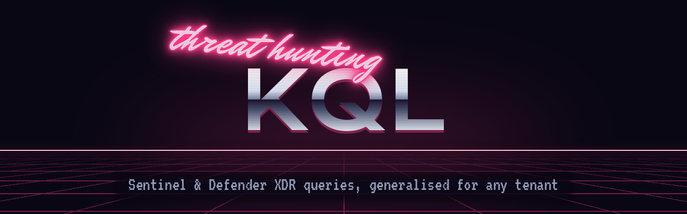

# KQL Hunting Library

KQL I wrote while working as a SOC analyst on Microsoft Sentinel and Defender XDR, cleaned up and generalised so it runs in any tenant. Every query starts with `let` parameters (time range, countries, device name) instead of hard-coded values.

| Folder | What's inside |
| --- | --- |
| [`identity/`](identity) | Password-correct-but-blocked sign-ins: catching credentials that are already compromised before MFA fatigue or a token theft finishes the job |
| [`email/`](email) | One-row-per-email investigation joining the four Defender for Office 365 tables |
| [`ioc/`](ioc) | Hash sweep across email attachments and endpoints with mixed MD5 / SHA-1 / SHA-256 input |
| [`incident-response/`](incident-response/vm-triage.md) | 14 triage queries to scope one compromised machine |
| [`rule-enhancements/`](rule-enhancements) | Built-in Sentinel rules enriched with user, session and parent process |

## Using them

Open **Microsoft Sentinel → Logs** or **Defender XDR → Advanced hunting**, paste a query, and adjust the `let` lines at the top. Defender tables use `Timestamp`. The same tables in Sentinel use `TimeGenerated`, so swap the column name if you run a Defender query in Sentinel.

## What's deliberately not here

Everything in this repo was rewritten from scratch for public use. No customer names, tenant data, IOCs from real incidents, or results from client environments are included.

## Credits

Queries I hunt with but didn't write live in their authors' repos. Go there for them:
- [Bert-JanP / Hunting-Queries-Detection-Rules](https://github.com/Bert-JanP/Hunting-Queries-Detection-Rules)
- [reprise99 / Sentinel-Queries](https://github.com/reprise99/Sentinel-Queries) (Matt Zorich)
- [Azure / Azure-Sentinel](https://github.com/Azure/Azure-Sentinel) (Microsoft hunting queries and analytics rules)

## License

[MIT](LICENSE)
